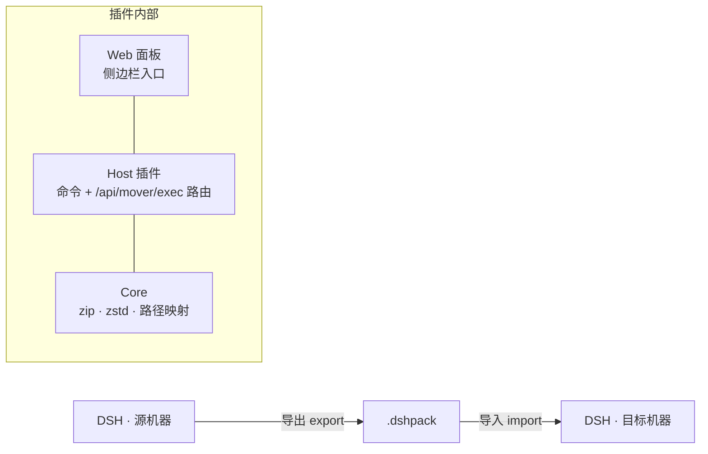

# dsh-pack-and-go

> **打包就走。** 把 DSH 的「对话 + 工作区」装进一个 `.dshpack` 文件，换台电脑（或换个平台）继续用。

[](./package.json)
[](./tests)
[](./docs/SPEC.md)

---

## ✨ 它能做什么

| 能力 | 说明 |
|---|---|
| 💬 **对话迁移** | 把对话（含历史消息、附件引用）完整带到另一个 DSH |
| 📁 **工作区迁移** | 项目文件、目录结构一起带走；空文件夹也保留骨架 |
| 🎯 **只导工作区** | 不带任何对话，只搬项目（适合代码库/素材库） |
| 🔁 **覆盖即回滚** | 重新导入旧包 = 把对话恢复到导出时的状态 |
| 🧩 **fork 链** | 分支/子代理对话默认连带导出 |
| 📎 **附件** | 图片、文档等按内容寻址打包与恢复 |
| 🔗 **符号链接** | 文件链接自动解引用；目录/损坏链接跳过并报告 |
| 🔐 **权限保真** | POSIX 目标按包内文件 mode 恢复（剥离 setuid/setgid）；Windows 目标忽略（ADR-0016 B1） |
| 🚀 **零额外依赖** | 只用 Node 内置能力（zstd、zip、流式 IO） |

导入时如果对话已存在，你可以选择 **跳过** 或 **覆盖**；覆盖会先备份，目标目录不同时会自动执行「**迁移覆盖**」并明确提示原/新位置。

---

## 🧭 平台支持

| 平台 | 状态 |
|---|---|
| Windows 10/11 | ✅ 已完成全链路验证（导入/导出/CDP UI） |
| macOS | 🧪 代码与测试就绪，CI 待跑 |
| Linux（含服务器） | 🧪 代码与测试就绪，CLI 可用，CI 待跑 |
| WSL / Termux | 🧪 按 Node 运行环境支持（未单独验证） |

要求：**Node.js ≥ 22.15**、装有 DSH 的任意 profile。

---

## 🚀 快速开始

### 安装

```bash
# 方式 A：本地目录（开发/内测）
dsh plugin --profile <profile> add /path/to/dsh-pack-and-go

# 方式 B：tarball（npm pack 产物）
dsh plugin --profile <profile> add ./dsh-pack-and-go-0.2.0.tgz
```

也可以在 DSH 插件管理页添加本地路径。安装后侧边栏出现「**迁移对话或工作区**」入口。

### 使用（Web UI）

1. 打开侧边栏 →「迁移对话或工作区」；
2. **导出**：选择「对话 + 工作区」或「仅工作区」→ 填保存位置 → 开始打包；
3. **导入**：选包 → 填目标目录（默认 `~/dsh-pack-and-go-import`，可改）→ 选冲突策略 → 开始导入。

### 使用（CLI，无 GUI 环境）

```bash
# 导出对话（含工作区文件）
dsh-pack-and-go export --home /path/to/.dsh --out /tmp/pack.dshpack --files

# 仅导出工作区（可多次 --workspace）
dsh-pack-and-go export --home /path/to/.dsh --out /tmp/ws.dshpack \
  --workspace /path/to/workspace-a --workspace /path/to/workspace-b

# 导入（--target 必填；--overwrite 覆盖已存在对话）
dsh-pack-and-go import --home /path/to/.dsh --pack /tmp/pack.dshpack \
  --target /path/to/import-dir [--overwrite]
```

> 命令入口在聊天框也可用：`/mover export ...`、`/mover import ...`（命令名保留 `mover`）。

---

## 🧠 工作原理



- **Host 插件**：读取 DSH 的会话/工作区/附件服务，执行导出/导入；不依赖会话上下文，不写会话日志。
- **Web 面板**：侧边栏入口，负责选择、预览、冲突提示与结果反馈。
- **Core**：`.dshpack` 的 zip 容器、zstd 多帧会话读写、路径映射、预检、扫描、附件与工作区恢复。

几个关键设计：

- 会话日志是 **zstd 多帧**（header 帧 + 事件帧）。跨平台迁移只改写 header 的 `cwd`，历史消息里的路径文本不动；
- 附件按 **sha256 内容寻址**存储，打包/恢复都按引用去重；
- 导入后通过 DSH 服务登记工作区并 attach 会话；启动时自动修复「迁移后未归组/双记账」的会话；
- DSH 已打开的会话缓存在内存里，**覆盖回滚/迁移后的新位置需要重启 DSH** 才能显示——结果文本会明确提示。

---

## 📦 `.dshpack` 包结构协议

一个包就是**单个 zip 文件**（默认 deflate 压缩），导出端与导入端共享以下协议（`schemaVersion: 2`）。

```
我的包.dshpack
├─ manifest.json                     # 包清单（见下）
├─ README.txt                        # 人类可读说明
├─ sessions/                         # 对话
│  └─ <sessionId>/session.v4.jsonl.zstd
├─ workspaces/                       # 工作区文件
│  └─ <workspaceKey>/files/<相对路径>   # 目录条目以 / 结尾（保留空目录）
└─ attachments/v1/                   # 附件（内容寻址）
   ├─ objects/<sha前2>/<sha256>            # 图片对象
   ├─ file-objects/<sha前2>/<sha256>       # 文件对象
   └─ files/<sha前2>/<sha256>/<文件名>      # 文件引用
```

### `manifest.json` 字段

| 字段 | 类型 | 说明 |
|---|---|---|
| `schemaVersion` | number | 当前 `2`；过新/过旧会明确拒绝 |
| `createdAt` | string | 导出时间（ISO） |
| `source` | object | `{ platform, dshVersion, sessionFormat }` |
| `mode` | string | `sessions` / `workspaces` / `sessions+workspaces` |
| `sessions[]` | object[] | `{ id, title?, cwd, messageCount, sizeBytes, path, parentSessionId?, workspaceKey? }` |
| `workspaces[]` | object[] | `{ key, title, sourcePath, sourcePlatform, fileCount, sizeBytes, root }` |
| `attachments[]` | object[] | `{ id, kind, sizeBytes, path }` |

### 导入端语义

1. **路径映射**：每个工作区落到 `<目标目录>/<工作区标题>`；同名目录存在时按「已登记/空目录/非空未登记」分别复用、复用、加序号；
2. **会话写入**：改写 header `cwd` 到目标位置；同 id 冲突按「跳过 / 覆盖」处理；覆盖且目标不同 → **迁移覆盖**（备份并移除旧目录，结果提示原/新工作区与会话名）；
3. **空工作区**：包内无会话的工作区也登记并还原文件；
4. **附件**：只恢复实际写入会话引用的附件；
5. **旧格式**：`sessionFormat < 4` 直接写文件，由目标 DSH 打开时自动迁移（结果提示）。

---

## 🛡️ 安全与边界

- **不删除用户数据**：覆盖前备份到 `<DSH_HOME>/dsh-pack-and-go-backup/<时间戳>/`；
- **失败不回退**：目标目录不可写、包损坏等直接红字报错，不会静默换目录；
- **拒绝危险包**：路径穿越、绝对路径、截断/损坏 zip 在校验阶段拒绝；
- **重启提示**：已打开会话、迁移覆盖的新位置、空工作区需要重启 DSH 后显示（DSH 的内存缓存/启动索引限制）。

---

## 📚 文档

| 文档 | 内容 |
|---|---|
| [docs/SPEC.md](docs/SPEC.md) | 需求规格 v1.2 |
| [docs/DESIGN.md](docs/DESIGN.md) | 技术设计（含导入/导出行为决策树） |
| [docs/DECISIONS.md](docs/DECISIONS.md) | ADR 决策记录 |
| [docs/TEST-CASES.md](docs/TEST-CASES.md) | 黑盒用例 + 决策树覆盖矩阵 |
| [docs/DEVLOG.md](docs/DEVLOG.md) | 开发日志 |
| [docs/INDEX.md](docs/INDEX.md) | 当前状态与文档地图 |

---

## 🧪 测试

```bash
node --test "tests/unit/**/*.test.mjs" "tests/e2e/**/*.test.mjs"
```

当前 **203 项测试**：Linux 全通过；Windows 198 通过 + 5 个 POSIX 权限用例预期跳过。另有 CDP 无头浏览器用例覆盖真实 UI 路径（导出/导入/冲突/迁移提示/仅工作区）。

---

## 🗺️ 状态与限制

- 版本 `0.2.0`（SPEC v1.3），**尚未发布到 npm**；
- 取消功能与精确进度按用户决定不做（沿用转圈 + 阶段文案）；
- macOS 平台专项待 CI；Linux 已完成符号链接/权限位/大小写/权限保真验证；
- 已打开会话的回滚/迁移位置显示需要重启 DSH（DSH 未提供会话 reload API）。

---

## 📄 许可

MIT
